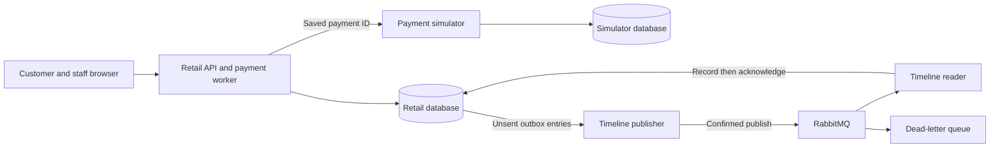
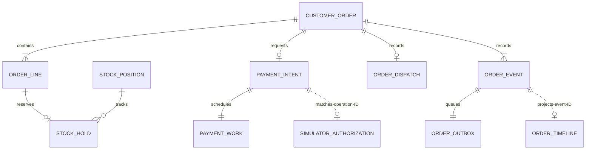

# Keeping stock and payments consistent through failures

A checkout reserves a whole basket, records a payment that can be retried safely, and gives staff enough history to explain and dispatch the order.

## Architecture

The two databases run on one PostgreSQL server with separate logins. The browser gets current order status and stock through the retail API. The staff timeline is a projection that can lag during a broker outage.

## Records that make retries safe

The dotted links represent identities carried between components. The simulator keeps a separate ledger keyed by payment operation ID. The timeline separately stores the broker event ID and uses order version to display events in sequence.

| Decision | Evidence |
| --- | --- |
| Lock basket stock and store the hold with the order in one transaction. | In a 100-buyer race for one unit, one got confirmation and 99 got a stock rejection. No second approval occurred. |
| Keep the hold while the payment result is unknown. Retry or reconcile under the saved operation ID. | An approval survived a lost reply and retail restart. After a 60-second simulator outage, ten held orders all confirmed within 9.93 seconds of recovery. |
| Publish committed events through an outbox. Record the projection before acknowledging the message. | A publisher crash and a reader crash each generated a duplicate delivery. Staff still saw one entry. Checkout and payment continued during a broker outage. |
| Measure submission and payment separately. | The burst produced a payment backlog after the final checkout response. The benchmark report gives its size, age and drain time. |

These results use simulated payments and one local machine. The benchmark covers a single stocked SKU and synthetic accounts. [Step 6 evidence](../tests/step-6-results.md) · [Step 7 evidence](../tests/step-7-results.md) · [Final comparison](BENCHMARKS.md)

